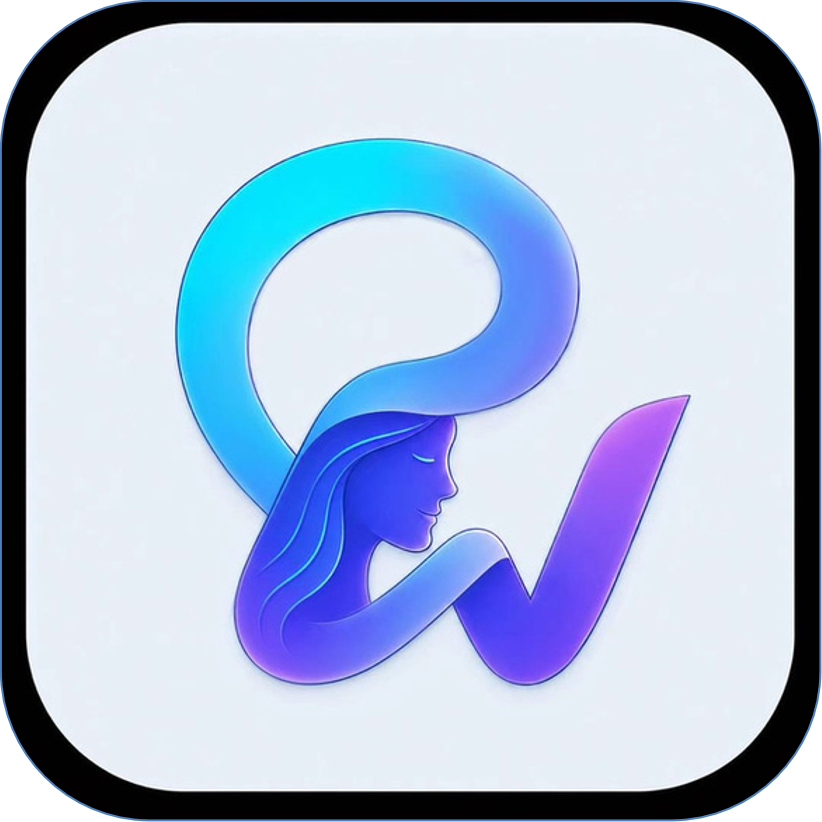

<h1 align="center">
   
  PersonaWeaver · 灵织
</h1>

## 一、项目定位

PersonaWeaver（灵织）是一款面向小说创作者、剧本作者及角色扮演创作者的本地知识管理工作台，旨在将分散的创作资料转化为可检索、可追溯、可持续维护的角色知识资产，为角色模拟和长期叙事提供支持。

## 二、核心功能

- **文档管理**：支持多种格式的文档导入、章节解析与阅读。
- **知识提取**：整理人物、关系、事件、物品及世界观设定。
- **知识检索**：结合语义检索与关键词检索，提高资料查找效率。
- **角色资产管理**：支持 Markdown 角色卡的创建、编辑与导出。
- **角色对话**：结合角色设定、作品资料和对话历史生成内容。
- **长期记忆**：规划静态记忆与动态记忆机制，维护角色经历和关系变化。
- **本地数据管理**：使用 SQLite 和本地文件保存业务数据及创作资料。

## 三、核心设计理念

1. **原文优先**：以作品原文为知识依据，支持资料来源追溯。
2. **结构化管理**：将非结构化文本转化为可维护的角色与剧情知识。
3. **混合检索**：结合向量检索、关键词召回及结果排序。
4. **角色持续性**：通过角色卡、对话历史和长期记忆保持角色设定的一致性。
5. **模块化设计**：分离前端、后端、数据存储和模型调用，便于扩展与维护。

## 四、系统架构与技术栈

- **前端**：Vue 3、Vite、Pinia、Vue Router、Element Plus。
- **后端**：FastAPI、Pydantic。
- **数据存储**：SQLite、本地文件系统。
- **模型接入**：Ollama、OpenAI 兼容接口、vivo 模型协议。
- **AI 应用编排**：LangChain（模型调用、Prompt、结构化输出）、LangGraph（复杂状态工作流）。
- **知识检索规划**：Qwen3-Embedding、BM25、Milvus、RRF、Cross-Encoder。
- **文档解析规划**：MinerU。

系统采用前后端分离架构，通过统一的模型适配层连接不同模型服务。上述检索与解析组件属于规划技术，实际接入情况以当前代码为准。

## 五、当前状态与发展规划

**当前已具备的基础能力：**
- 文档导入与章节阅读。
- 作品资料管理与任务状态记录。
- Markdown 角色卡管理。
- 角色对话及会话持久化。
- SQLite 与本地文件存储。

**后续重点方向：**
1. 完善文档解析与结构化分块。
2. 建设可追溯的混合检索系统。
3. 优化人物、关系与剧情信息提取。
4. 实现长期记忆的提取、去重与冲突处理。
5. 提升角色模拟的一致性与创作辅助能力。

## 六、项目总结

PersonaWeaver 以本地创作资料为基础，以结构化知识和证据追溯为核心，通过角色资产管理、混合检索与长期记忆，建立从原始文本到角色交互的完整工作流，帮助创作者更高效地管理作品设定，并支持长期、连贯的角色模拟与内容创作。

## 七、参考资料

1. **Tavern**：https://github.com/peppertaco/Tavern/
2. **SillyTavern**：https://github.com/SillyTavern/SillyTavern
3. **KouriChat**：https://github.com/KouriChat/KouriChat
4. **NovelAgent**：https://github.com/blackzhanzhan/novel_agent
5. **NovelFanGraph**：https://github.com/LucianaiB2004/novel-fan-graph
以上项目可为角色卡管理、角色扮演交互及相关功能设计提供参考。

## 八、未来发展方向

1. **深度知识检索**：完善语义检索、关键词召回与结果重排序，提高长篇文本的知识定位能力。
2. **智能角色资产构建**：自动提取人物、关系、事件及世界观设定，减少人工整理成本。
3. **长期记忆机制**：实现记忆提取、去重、更新与冲突处理，增强角色的持续性和一致性。
4. **多 Agent 协作**：探索多个智能体在剧情分析、角色塑造与创作辅助中的协同应用。
5. **多模态内容生成**：探索与 ViMax 等多 Agent 剧情长视频生成框架的结合，将角色设定、人物关系和剧情节点转化为视频创作的结构化输入。ViMax — https://github.com/HKUDS/ViMax